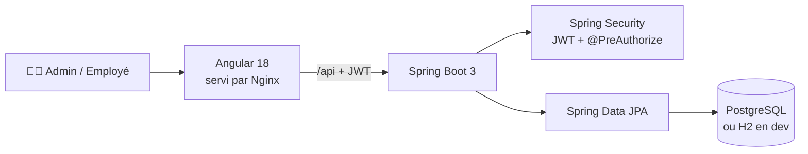
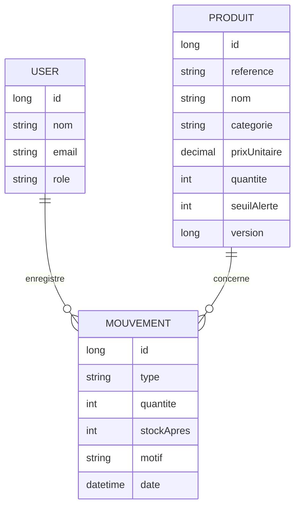

# 📦 StockFlow — Gestion de stock avec rôles et traçabilité

> Application web full stack de **gestion de stock** pour une PME : catalogue de produits, **entrées et sorties tracées**, **alertes de rupture**, tableau de bord et **export CSV**.
> Back-end **Spring Boot 3** avec **rôles** (administrateur / employé) et **JWT**, front-end **Angular 18**, déploiement **Docker Compose** + **PostgreSQL**.


---

## ✨ Fonctionnalités

### 👥 Deux rôles
| | Administrateur | Employé |
|---|:---:|:---:|
| Consulter les produits et le tableau de bord | ✅ | ✅ |
| Enregistrer des entrées et des sorties | ✅ | ✅ |
| Exporter l'inventaire en CSV | ✅ | ✅ |
| Créer, modifier, supprimer des produits | ✅ | ❌ (`403`) |

Les droits sont vérifiés **côté serveur** avec `@PreAuthorize` : masquer un bouton dans l'interface ne suffit pas.

### 📦 Produits
- Référence unique, nom, catégorie, prix unitaire, seuil d'alerte
- Recherche, filtre par catégorie et filtre « seulement les alertes »
- **Valeur du stock** calculée par produit
- La quantité **ne se modifie jamais directement** : elle évolue uniquement par des mouvements tracés

### 🔁 Mouvements de stock
- Entrée ou sortie, avec quantité et motif
- **Aperçu du stock avant validation** dans le formulaire
- **Refus des sorties supérieures au stock** (`409 Stock insuffisant`)
- Historique complet : qui, quand, pourquoi, et stock après chaque mouvement
- Le stock initial d'un nouveau produit est enregistré comme première entrée
- **Verrouillage optimiste** (`@Version`) : deux mises à jour simultanées ne peuvent pas fausser le stock

### 📊 Tableau de bord
- Valeur totale du stock, nombre de produits et d'unités
- Produits **sous leur seuil d'alerte**
- Entrées / sorties des 30 derniers jours
- Valeur du stock **par catégorie** et derniers mouvements

### 📄 Export
- Inventaire en **CSV** compatible Excel (séparateur `;`, accents conservés)

## 🏗️ Architecture





```
stockflow/
├── backend/                     # API Spring Boot
│   └── src/main/java/com/mayssadhahri/stockflow/
│       ├── controller/          # Produits, mouvements, tableau de bord, authentification
│       ├── service/             # Règles métier (stock, alertes, export)
│       ├── repository/          # Spring Data JPA (requêtes JPQL, EntityGraph)
│       ├── entity/              # Produit, Mouvement, User, Role
│       ├── dto/                 # Records + validation
│       ├── security/            # JWT
│       ├── config/              # Sécurité, CORS, données de démonstration
│       └── exception/           # Gestion globale des erreurs
├── frontend/                    # Application Angular
│   └── src/app/
│       ├── core/                # Services, intercepteur, guard, modèles
│       ├── pages/               # Connexion, tableau de bord, produits, mouvements
│       └── shared/              # Formulaires produit et mouvement (modales)
├── docker-compose.yml
└── .github/workflows/ci.yml
```

## 🚀 Lancer le projet

### Option 1 — Docker

```bash
docker compose up -d --build
```

- Application : **http://localhost:4200**
- API : http://localhost:8080 · Swagger : http://localhost:8080/swagger-ui.html

### Option 2 — En développement

```bash
# Back-end (Java 17 + Maven) — base H2 en mémoire
cd backend
mvn spring-boot:run

# Front-end (Node.js 20+), dans un autre terminal
cd frontend
npm install
npm start          # http://localhost:4200
```

> 💡 **Comptes de démonstration** créés au démarrage (boutons sur la page de connexion) :
> `admin@stockflow.tn` / `admin1234` et `employe@stockflow.tn` / `employe1234`

### Configuration

| Variable | Rôle | Défaut |
|---|---|---|
| `DB_URL` / `DB_USERNAME` / `DB_PASSWORD` | Connexion à la base | H2 en mémoire |
| `JWT_SECRET` | Clé de signature des jetons (Base64, 256 bits min.) | clé de développement |
| `JWT_EXPIRATION_MINUTES` | Durée de validité d'un jeton | `480` (8 h) |
| `CORS_ORIGINS` | Origines autorisées | `http://localhost:4200` |
| `APP_DEMO_DATA` | Créer les comptes et produits de démonstration | `true` |

## 🔌 API REST

| Méthode | Route | Rôle | Description |
|---|---|---|---|
| `POST` | `/api/auth/register` | public | Inscription (rôle employé) |
| `POST` | `/api/auth/login` | public | Connexion → jeton JWT |
| `GET` | `/api/produits?q=&categorie=&alerte=` | tous | Liste filtrée |
| `GET` | `/api/produits/{id}` | tous | Détail |
| `GET` | `/api/produits/categories` | tous | Catégories existantes |
| `GET` | `/api/produits/export` | tous | Inventaire CSV |
| `POST` / `PUT` / `DELETE` | `/api/produits[/{id}]` | **admin** | Gestion du catalogue |
| `POST` | `/api/mouvements` | tous | Entrée ou sortie |
| `GET` | `/api/mouvements?produitId=&limite=` | tous | Historique |
| `GET` | `/api/dashboard` | tous | Indicateurs |

## 🧪 Tests

```bash
cd backend && mvn verify
```

Tests d'intégration (MockMvc + H2) : accès sans jeton, **refus d'un employé sur les routes admin**, mise à jour du stock par entrées et sorties, **refus d'une sortie supérieure au stock**, alertes, référence en double, validation, modification et suppression, tableau de bord, export CSV. Tests unitaires du service JWT.

La CI GitHub Actions compile et teste le back-end, construit le front-end Angular et les images Docker.

## 🛣️ Pistes d'amélioration

- Gestion des fournisseurs et des bons de commande
- Graphique d'évolution du stock dans le temps
- Lecture de codes-barres depuis la caméra (application mobile)

---

👩‍💻 **Mayssa Dhahri** — Élève-ingénieure en Génie Logiciel, École Polytechnique de Sousse
[LinkedIn](https://www.linkedin.com/in/mayssa-dhahri/) · [GitHub](https://github.com/mayssadhahri1)

*Réalisé avec l'aide d'un assistant IA.*
